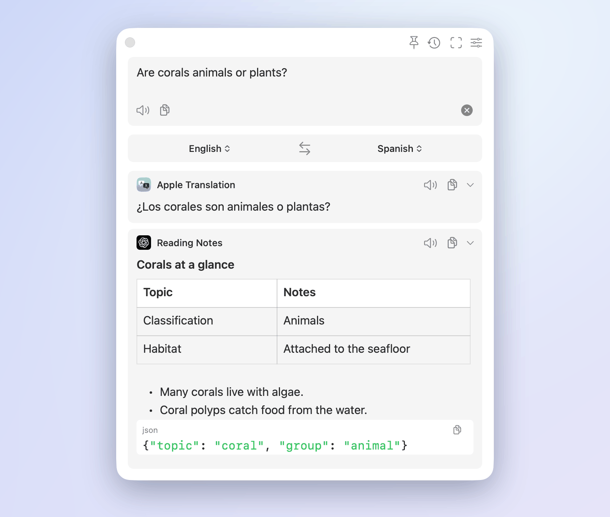
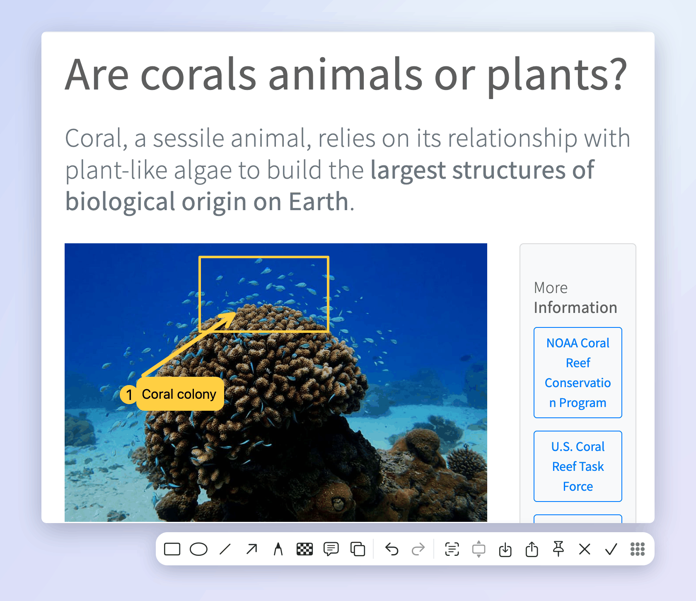
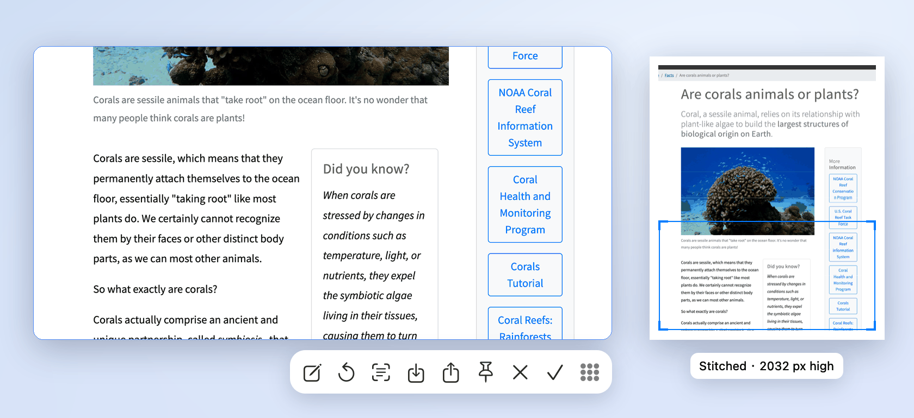
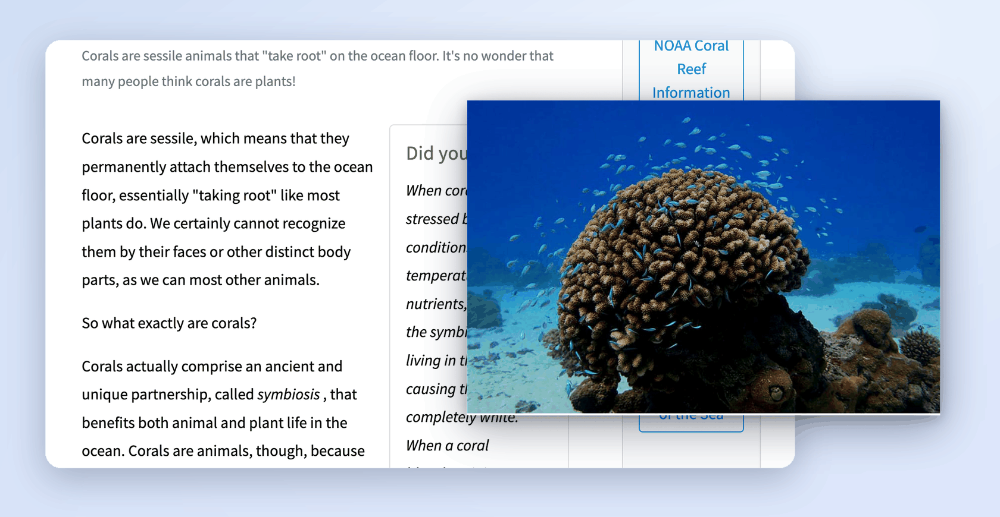
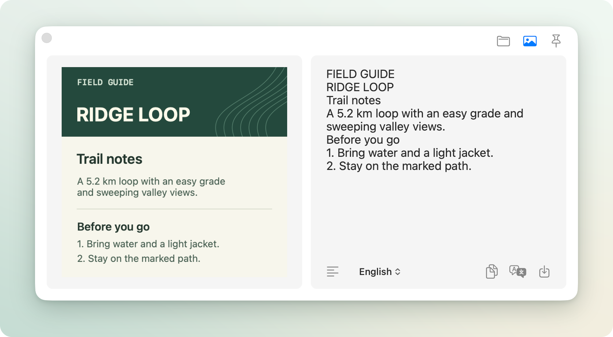

<p align="center">
  
</p>

<h1 align="center">Seven</h1>

<p align="center">
  <strong>A native macOS menu bar app for AI translation, screenshot annotation, and on-device text recognition.</strong>
</p>

<p align="center">
  <a href="https://github.com/crismakes/Seven/releases/latest"></a>
  <a href="https://github.com/crismakes/Seven/releases"></a>
  
  
  <a href="https://github.com/crismakes/Seven/actions/workflows/ci.yml"></a>
  <a href="LICENSE"></a>
</p>

<h3 align="center"><a href="https://github.com/crismakes/Seven/releases/latest">Download Latest Release</a></h3>

<p align="center">Signed &amp; Notarized by Apple · Auto-updates built in</p>

<p align="center">
  <strong>English</strong> · <a href="README.zh-CN.md">简体中文</a>
</p>

<p align="center">
  <picture>
    <source media="(prefers-color-scheme: dark)" srcset="Docs/assets/hero-dark.png" />
    
  </picture>
</p>

## Why Seven

Read a foreign-language document, reply in another language, or mark up a screenshot from the same menu bar app. Seven is open source under MIT and notarized by Apple.

## Features

### Translate and rewrite across apps

- **Selection and input translation** — Select a sentence in a document you’re reading to see the translation, or type or paste text into the panel.
- **Screenshot translation** — Draw a box around subtitles or foreign text in an image to see the translation.
- **Translate & Replace** — Writing a message in WeChat or Telegram? Select the Chinese text in the message field and replace it with English, right where you typed it.
- **Custom AI prompts** — Turn a passage you just read into three key points and see the result in the translation panel.
- **Translation services** — Use Apple Translation, Youdao, Google, or the offline English–Chinese dictionary, or bring your own AI service.
- **History and favorites** — Find an earlier translation, save it as a favorite, or export the collection as JSON or Markdown.

### Capture, annotate, and pin

Giving feedback on a page? Capture a region or window, then add an arrow or a numbered callout to show what needs changing.

<p align="center">
  
</p>

#### Scrolling capture

When a document takes up several screens, scroll to stitch it into one image and watch the preview as it grows.

<p align="center">
  
</p>

#### Floating pins

Keep a design reference in sight while you work by pinning a screenshot above your other windows.

<p align="center">
  
</p>

### Extract text on your Mac

Need a quote from a scanned page? Select the area, check the recognized text next to the original, and copy what you need. Recognition runs on your Mac.

<p align="center">
  
</p>

The screenshots use a public [NOAA National Ocean Service article about corals](https://oceanservice.noaa.gov/facts/coral.html).

### Make it yours

Customize shortcuts, switch themes, or choose one of six interface languages in Settings.

## Download

Seven runs on **macOS 14.0 (Sonoma) or later** on Apple Silicon and Intel.

1. Under **Assets**, download and open the `.dmg`, or download and unzip the `.zip`. [Latest GitHub Release](https://github.com/crismakes/Seven/releases/latest)
2. Drag **Seven** into **Applications**, then open it from there.

Seven checks for updates automatically. In **Settings → About**, you can check manually or turn on **Automatically Download and Install**. Signed, notarized releases are listed in the [update feed](appcast.xml).

Grant **Accessibility** for cross-app selection, Translate & Replace, and optional smart element selection. Grant **Screen Recording** for screenshots, scroll capture, screenshot translation, and screen OCR.

<details>
<summary>Default keyboard shortcuts</summary>

| Action | Default shortcut |
|---|---|
| Selection Translate | `⌥D` |
| Input Translate | `⌥A` |
| Screenshot Translate | `⌥S` |
| Translate & Replace | `⌃⌥T` |
| Region Screenshot | `⌃⌥S` |
| Region OCR | `⌃⌥O` |
| Other capture, image, OCR, and pin actions | Unassigned by default |

</details>

## Privacy

- **Zero telemetry** — Seven collects no usage analytics.
- **Credentials stay on your Mac** — API keys are stored per service instance in a local file with `0700` directory and `0600` file permissions. Keys are excluded from exports and logs.
- **On-device OCR** — Apple Vision recognizes text locally. Online translation sends text to the chosen provider. If local language detection is uncertain, the selected online detector (Youdao by default) can receive up to 500 characters of translation input. You can choose on-device detection in Settings. Speech synthesis defaults to Youdao and requests audio only when you start playback.
- **Technical diagnostics** — The diagnostics pane is hidden in official releases. Development logs record technical events and metrics such as timings and dimensions. They exclude user text, clipboard and OCR content, images, window titles, and credentials.

## Build from source

<details>
<summary>Build, test, and package Seven</summary>

Use **Xcode 26 or later** to build and package Seven. The package declares Swift tools 5.9, and the pinned Markdown dependency requires **Swift 6.2 or later**, which Xcode 26 includes.

```sh
git clone https://github.com/crismakes/Seven.git
cd Seven

swift build
swift test

# Run once if you don't have a Developer ID Application signing identity
./setup-local-signing.sh

./build-app.sh release
open Seven.app
```

SwiftPM fetches the pinned dependencies on the first build. The packaging script uses the certificate name or SHA-1 fingerprint in `SEVEN_SIGN_IDENTITY` when set. Otherwise, it looks for Developer ID Application in the keychain search list, then falls back to the local signing identity. Use `--local-signing` to skip Developer ID auto-detection or `--universal` to package for both Apple Silicon and Intel. For an isolated development build, run `./build-app.sh release --variant dev`.

See [engineering guidelines](AGENTS.md) and the [maintainer release guide (Simplified Chinese)](Docs/Release.md).

</details>

## License & Feedback

Seven is open source under the [MIT License](LICENSE). Bug reports and feature ideas are welcome on [GitHub Issues](https://github.com/crismakes/Seven/issues).
