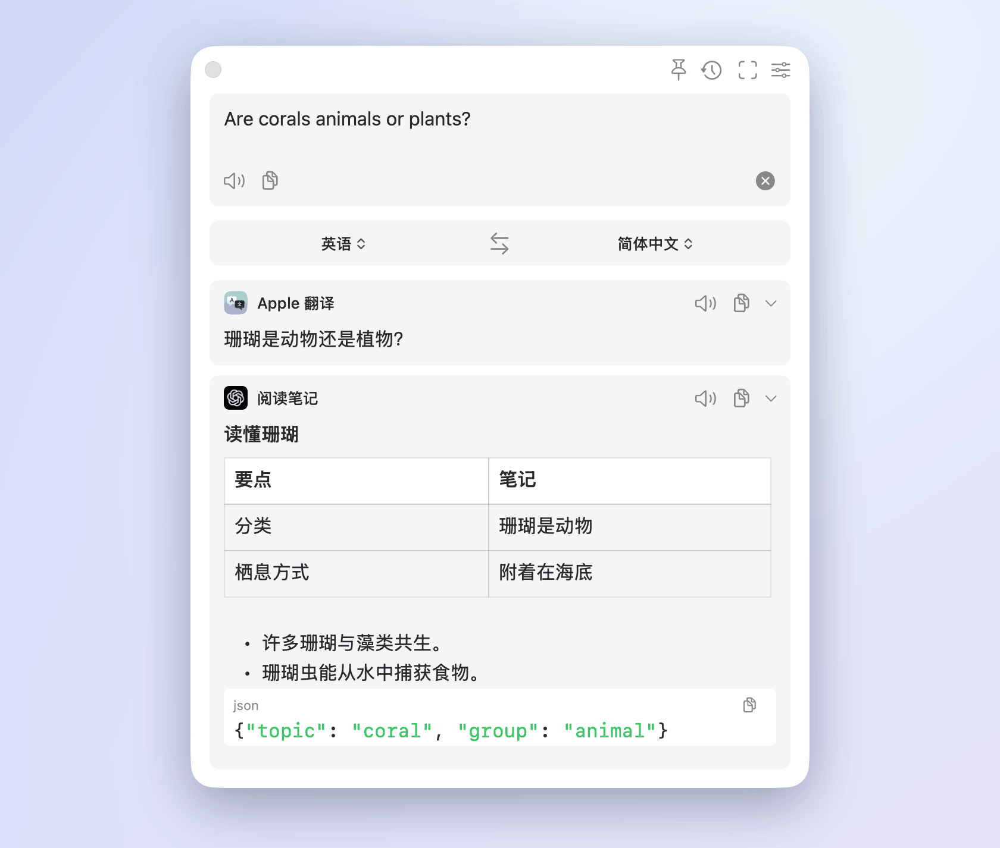
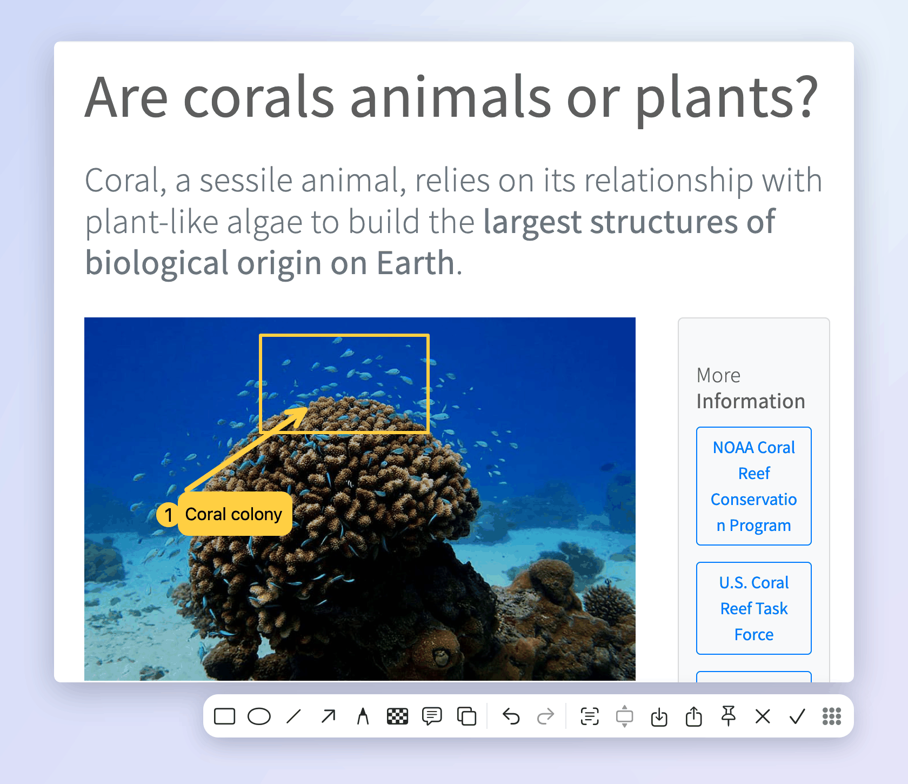
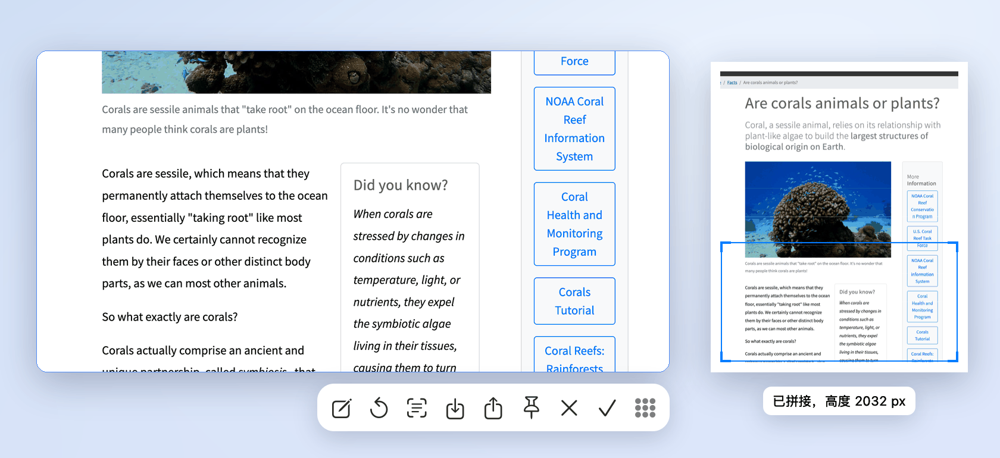
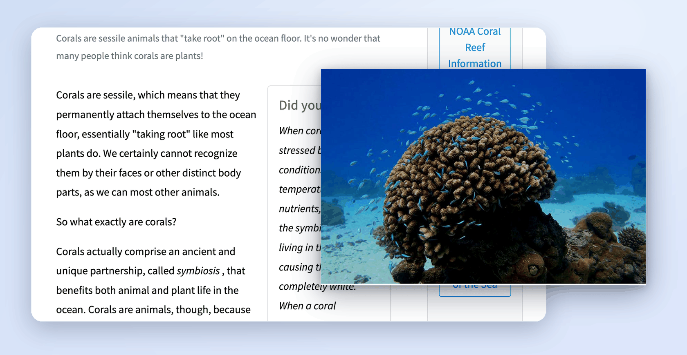
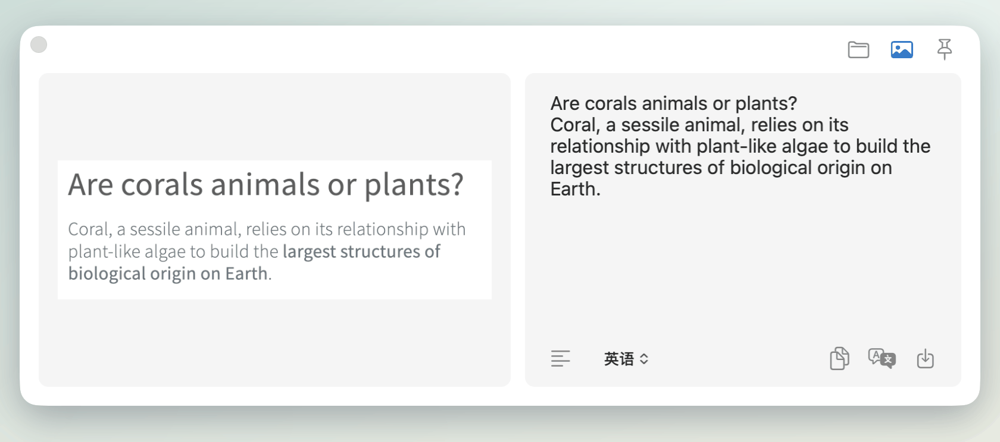

<p align="center">
  
</p>

<h1 align="center">Seven</h1>

<p align="center">
  <strong>Seven 是一个原生 macOS 菜单栏工具，用来做 AI 翻译、截图标注和本机文字识别。</strong>
</p>

<p align="center">
  <a href="https://github.com/crismakes/Seven/releases/latest"></a>
  <a href="https://github.com/crismakes/Seven/releases"></a>
  
  
  <a href="https://github.com/crismakes/Seven/actions/workflows/ci.yml"></a>
  <a href="LICENSE"></a>
</p>

<h3 align="center"><a href="https://github.com/crismakes/Seven/releases/latest">下载最新版本</a></h3>

<p align="center">Apple 签名公证 · 支持应用内自动更新</p>

<p align="center">
  <a href="README.md">English</a> · <strong>简体中文</strong>
</p>

<p align="center">
  <picture>
    <source media="(prefers-color-scheme: dark)" srcset="Docs/assets/hero-dark-zh-CN.png" />
    
  </picture>
</p>

## 为什么选择 Seven

读外语资料、回外语消息、给截图加标注，都能用同一个菜单栏工具完成。Seven 采用 MIT 协议开源，并通过 Apple 公证。

## 核心功能

### 跨应用翻译与改写

- **划词与输入翻译** —— 读英文文档时选中一句，就能在浮窗看译文，也可以直接在浮窗输入或粘贴。
- **截图翻译** —— 框住视频字幕或图片上的外语，直接看译文。
- **翻译并替换** —— 在微信或 Telegram 写消息时，选中输入框里的中文，直接在原处换成英文。
- **自定义 AI 提示词** —— 把刚读到的一段资料整理成三条要点，直接在浮窗看结果。
- **翻译服务** —— 可用 Apple 翻译、有道、Google 和离线英汉词典，也可以接入自己的 AI 服务。
- **历史与收藏** —— 找回之前的译文，收藏常用结果，或把记录导出为 JSON 或 Markdown。

### 截图、标注与钉图

给同事反馈页面问题时，截取区域或整个窗口，用箭头或序号标出要改的地方。

<p align="center">
  
</p>

#### 滚动长截图

一页文档有好几屏时，边滚动边拼成一张长图，还能实时预览。

<p align="center">
  
</p>

#### 悬浮钉图

边做设计边看参考图时，把截图钉在其他窗口上方，随时对照。

<p align="center">
  
</p>

### 在本机提取文字

想引用扫描件里的一段话，框住那一块，对照原图确认后就能复制。文字识别在 Mac 上完成。

<p align="center">
  
</p>

截图素材来自 [NOAA 国家海洋局的珊瑚科普文章](https://oceanservice.noaa.gov/facts/coral.html)。

### 按自己的习惯设置

在设置里自定义快捷键、切换主题，也可以从六种界面语言中选择。

## 下载

支持 **macOS 14.0（Sonoma）及以上版本**，兼容 Apple 芯片和 Intel Mac。

1. 在 **Assets** 中下载并打开 `.dmg`，也可以下载并解压 `.zip`。 [GitHub 最新版本](https://github.com/crismakes/Seven/releases/latest)
2. 将 **Seven** 拖入 **Applications（应用程序）**，再从应用程序文件夹打开。

Seven 会自动检查更新。你也可以在「设置 → 关于」手动检查，或开启「自动下载并安装」。已签名并公证的版本列在[更新源](appcast.xml)中。

跨应用划词、「翻译并替换」和可选的智能选区需要**辅助功能**权限。截图、长截图、截图翻译和屏幕 OCR 需要**屏幕录制**权限。

<details>
<summary>默认快捷键</summary>

| 功能 | 默认快捷键 |
|---|---|
| 划词翻译 | `⌥D` |
| 输入翻译 | `⌥A` |
| 截图翻译 | `⌥S` |
| 翻译并替换 | `⌃⌥T` |
| 区域截图 | `⌃⌥S` |
| 框选 OCR | `⌃⌥O` |
| 其他截图、图片、OCR 与钉图操作 | 默认未设置 |

</details>

## 隐私

- **零遥测** —— Seven 不收集使用统计。
- **凭据留在本机** —— API Key 按服务实例存入本地文件，目录权限为 `0700`，文件权限为 `0600`。导出和日志均不包含密钥。
- **本机 OCR** —— Apple Vision 在本机识别文字。使用在线翻译时，文本会发给所选服务。若本机语种识别不确定，所选联网检测服务（默认有道）最多可收到 500 个字符的翻译输入，也可在设置中选择仅本机识别。语音合成默认使用有道，主动朗读时才请求在线语音。
- **技术诊断** —— 正式版隐藏诊断入口。开发版日志只记录技术事件、耗时、尺寸等指标，不记录原文、译文、剪贴板或 OCR 内容、图像、窗口标题和凭据。

## 从源码构建

<details>
<summary>构建、测试与打包 Seven</summary>

从源码构建和打包使用 **Xcode 26 或更新版本**。项目声明的 Swift 工具版本为 5.9，锁定的 Markdown 依赖实际要求 **Swift 6.2 或更新版本**，Xcode 26 已包含该工具链。

```sh
git clone https://github.com/crismakes/Seven.git
cd Seven

swift build
swift test

# 没有 Developer ID Application 签名身份时执行一次
./setup-local-signing.sh

./build-app.sh release
open Seven.app
```

SwiftPM 首次构建时下载锁定的依赖。打包脚本优先使用 `SEVEN_SIGN_IDENTITY` 指定的证书全名或 SHA-1 指纹，其次查找钥匙串搜索列表中的 Developer ID Application，最后使用本机开发签名。可用 `--local-signing` 跳过 Developer ID 自动查找，或用 `--universal` 同时打包 Apple 芯片与 Intel 版本。需要独立的开发试用包时，运行 `./build-app.sh release --variant dev`。

参阅[工程规范](AGENTS.md)和[维护者发版指南](Docs/Release.md)。

</details>

## 开源协议与反馈

Seven 采用 [MIT 协议](LICENSE)开源。欢迎在 [GitHub Issues](https://github.com/crismakes/Seven/issues) 反馈问题或提出功能建议。
