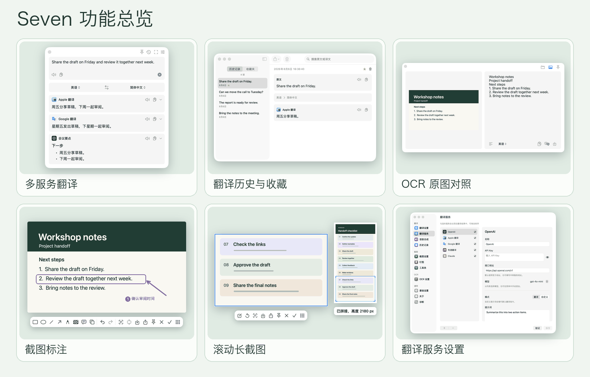

<p align="center">
  
</p>

<h1 align="center">Seven</h1>

<p align="center">
  <strong>Seven 是一个原生 macOS 菜单栏工具，用来做 AI 翻译、截图标注和本机文字识别。</strong>
</p>

<p align="center">
  <a href="https://github.com/crismakes/Seven/releases/latest"></a>
  <a href="https://github.com/crismakes/Seven/releases"></a>
  
  
  <a href="https://github.com/crismakes/Seven/actions/workflows/ci.yml"></a>
  <a href="LICENSE"></a>
</p>

<h3 align="center"><a href="https://github.com/crismakes/Seven/releases/latest">下载最新版本</a></h3>

<p align="center">Apple 签名公证 · 支持应用内自动更新</p>

<p align="center">
  <a href="README.md">English</a> · <strong>简体中文</strong>
</p>

<p align="center">
  <picture>
    <source media="(prefers-color-scheme: dark)" srcset="Docs/assets/ui-overview-dark-zh-CN.png" />
    
  </picture>
</p>

## 为什么选择 Seven

读外语资料、回外语消息、给截图加标注，都能用同一个菜单栏工具完成。Seven 采用 MIT 协议开源，并通过 Apple 公证。

## 核心功能

### 跨应用翻译与改写

- **跨应用划词与输入翻译** —— 在其他应用选中文字后按快捷键即可翻译，也可以用快捷键打开输入浮窗。目标语言可自动按第一、第二语言选择，也可手动指定。
- **截图翻译** —— 按快捷键框选网页图片、视频字幕等无法直接选取的文字。Seven 先在本机识别，再把文字送入翻译浮窗。
- **翻译并替换** —— 在可编辑的输入框选中文字后按快捷键。Seven 核对原输入框及选区后，将结果写回原处。比如在微信或 Telegram 回消息时，可以先用中文打草稿，再在输入框里换成英文。
- **翻译服务与朗读** —— 支持 Apple 翻译、有道、Google 和可下载的离线英汉词典。也可用自己的 API Key 接入 OpenAI、Claude、Gemini、DeepSeek 等流式服务或兼容接口。原文和结果均可复制及朗读。
- **AI 自定义提示词** —— 在翻译浮窗总结、改写或提取要点。结果可按 Markdown 排版，代码块可一键复制。
- **历史和收藏** —— 按原文或译文搜索多服务记录，把常用结果单独收藏，并将当前集合导出为 JSON 或 Markdown。

### 截图、标注与钉图

- **区域、整窗与智能选区** —— 冻结屏幕后拖选区域或点选窗口，也可组合多个窗口、恢复上次选区或复制 HEX 色值。开启智能选区后可选取窗口里的控件。
- **无损标注** —— 添加箭头、形状、序号、文字、马赛克或聚焦高亮。可撤销、重做，并按原始分辨率导出 PNG/JPG 或通过 macOS 分享。比如用箭头标出网页上需要同事修改的按钮。

#### 滚动长截图

向上或向下滚动时实时拼接并预览。完成后可继续标注、复制、保存、分享、钉图或提取文字。

#### 悬浮钉图

将截图、剪贴板图片或文字固定在其他窗口上方。可调整缩放和不透明度，也可在原处重新标注。做设计时，可以钉住参考图，边做边对照。

### 在本机提取文字

- **本机 OCR 与智能排版** —— Vision 在设备上识别文字。识别后可在原图中直接选择文字，在旁边编辑、整理段落、翻译或导出 TXT。想引用扫描件里的一段话，可以先对照原图校对，再复制到笔记里。
- **静默 OCR 与图片导入** —— 将识别结果直接复制到剪贴板，或通过 Finder「打开方式」、拖放和剪贴板导入图片。也可直接导入本地图片进行标注。

### 按自己的习惯设置

- 在设置中调整常用语言、翻译服务顺序、全局快捷键和截图工具条。浮窗可跟随鼠标或记住位置，也可钉住。
- 支持系统外观、浅色和深色主题、减弱动态效果以及六种界面语言（简中、繁中、英、日、韩、西）。

## 下载

支持 **macOS 14.0（Sonoma）及以上版本**，兼容 Apple 芯片和 Intel Mac。

1. 在 **Assets** 中下载并打开 `.dmg`，也可以下载并解压 `.zip`。 [GitHub 最新版本](https://github.com/crismakes/Seven/releases/latest)
2. 将 **Seven** 拖入 **Applications（应用程序）**，再从应用程序文件夹打开。

Seven 会自动检查更新。你也可以在「设置 → 关于」手动检查，或开启「自动下载并安装」。已签名并公证的版本列在[更新源](appcast.xml)中。

跨应用划词、「翻译并替换」和可选的智能选区需要**辅助功能**权限。截图、长截图、截图翻译和屏幕 OCR 需要**屏幕录制**权限。

<details>
<summary>默认快捷键</summary>

| 功能 | 默认快捷键 |
|---|---|
| 划词翻译 | `⌥D` |
| 输入翻译 | `⌥A` |
| 截图翻译 | `⌥S` |
| 翻译并替换 | `⌃⌥T` |
| 区域截图 | `⌃⌥S` |
| 框选 OCR | `⌃⌥O` |
| 其他截图、图片、OCR 与钉图操作 | 默认未设置 |

</details>

## 隐私

- **零遥测** —— Seven 不收集使用统计。
- **凭据留在本机** —— API Key 按服务实例存入本地文件，目录权限为 `0700`，文件权限为 `0600`。导出和日志均不包含密钥。
- **本机 OCR** —— Apple Vision 在本机识别文字。使用在线翻译时，文本会发给所选服务。若本机语种识别不确定，所选联网检测服务（默认有道）最多可收到 500 个字符的翻译输入，也可在设置中选择仅本机识别。语音合成默认使用有道，主动朗读时才请求在线语音。
- **技术诊断** —— 正式版隐藏诊断入口。开发版日志只记录技术事件、耗时、尺寸等指标，不记录原文、译文、剪贴板或 OCR 内容、图像、窗口标题和凭据。

## 从源码构建

<details>
<summary>构建、测试与打包 Seven</summary>

从源码构建和打包使用 **Xcode 26 或更新版本**。项目声明的 Swift 工具版本为 5.9，锁定的 Markdown 依赖实际要求 **Swift 6.2 或更新版本**，Xcode 26 已包含该工具链。

```sh
git clone https://github.com/crismakes/Seven.git
cd Seven

swift build
swift test

# 没有 Developer ID Application 签名身份时执行一次
./setup-local-signing.sh

./build-app.sh release
open Seven.app
```

SwiftPM 首次构建时下载锁定的依赖。打包脚本优先使用 `SEVEN_SIGN_IDENTITY` 指定的证书全名或 SHA-1 指纹，其次查找钥匙串搜索列表中的 Developer ID Application，最后使用本机开发签名。可用 `--local-signing` 跳过 Developer ID 自动查找，或用 `--universal` 同时打包 Apple 芯片与 Intel 版本。需要独立的开发试用包时，运行 `./build-app.sh release --variant dev`。

参阅[工程规范](AGENTS.md)和[维护者发版指南](Docs/Release.md)。

</details>

## 开源协议与反馈

Seven 采用 [MIT 协议](LICENSE)开源。欢迎在 [GitHub Issues](https://github.com/crismakes/Seven/issues) 反馈问题或提出功能建议。
